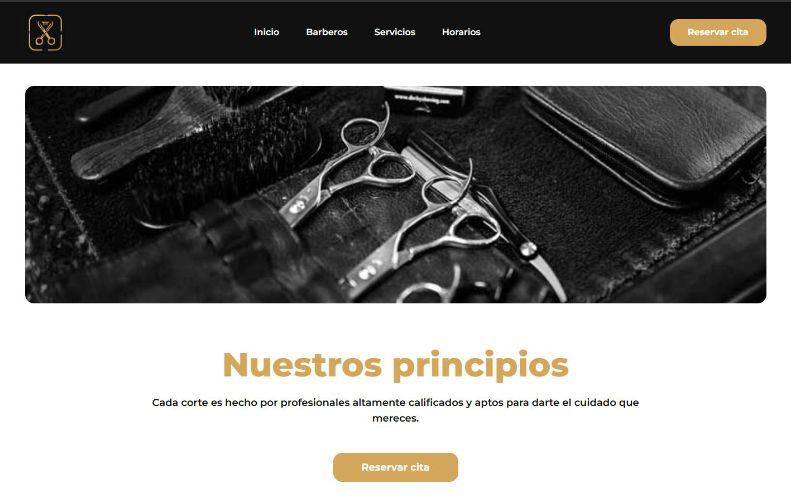
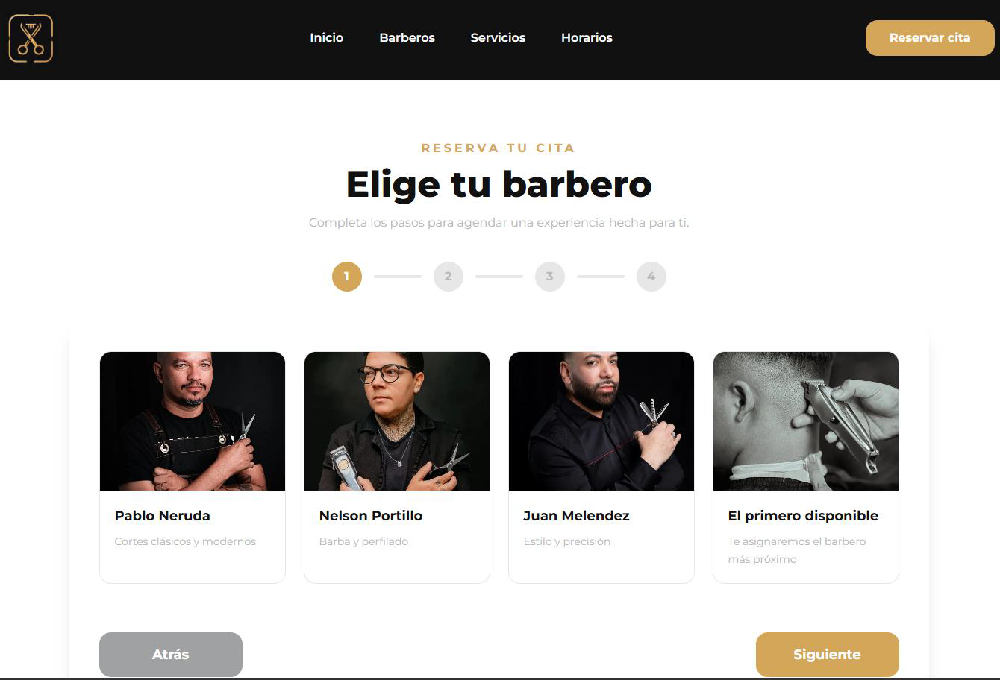
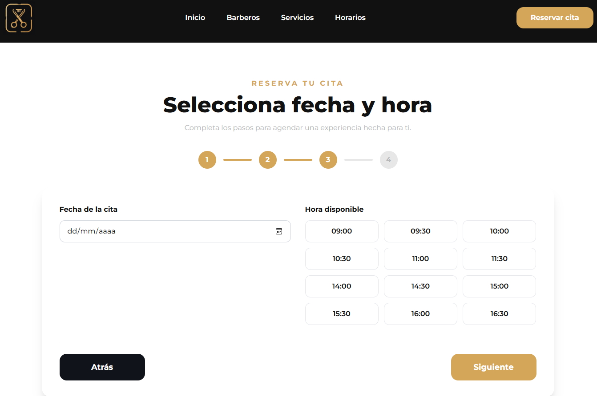
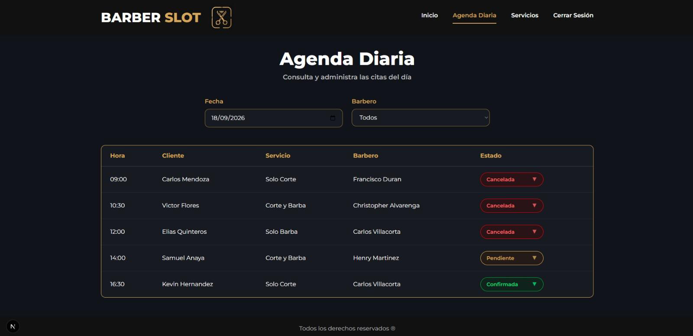

# BarberSlot

BarberSlot es un proyecto académico orientado a la gestión de citas y servicios de una barbería. El sistema está dividido en una aplicación web, una aplicación móvil y un backend independiente que permitirá compartir la misma lógica y fuente de datos entre ambas plataformas.

El proyecto fue desarrollado para la asignatura **Diseño y Programación de Software Multiplataforma**.

[](https://creativecommons.org/licenses/by-nc-sa/4.0/)

## Contexto

BarberSlot se desarrolla para **Barbería Estilo Clásico**, ubicada en Santa Tecla, La Libertad. La barbería atiende por orden de llegada, lo que en horas de alta demanda genera aglomeración y tiempos de espera que el cliente no puede prever.

BarberSlot permite que el cliente agende su cita en línea eligiendo barbero, servicio y horario disponible, y le da al negocio una agenda ordenada y un historial de citas.

## Funcionalidades principales

- Selección del barbero de preferencia.
- Selección del servicio con su duración y precio.
- Horarios disponibles calculados según el barbero, la duración del servicio y las citas existentes.
- Prevención de reservas simultáneas en el mismo horario.
- Confirmación de la cita en pantalla y por correo electrónico.
- Panel administrativo con agenda diaria filtrable por barbero.
- Gestión de servicios (alta, edición y baja) por parte del administrador.
- Inicio de sesión con correo o con Google mediante Firebase Authentication.

## Mockups

Las interfaces se diseñaron en Figma. El archivo completo puede consultarse en:

[BarberSlot en Figma](https://www.figma.com/design/DtxkBzNf8prr5rXMgWK4zm/BarberSlot?node-id=0-1&t=NpfwyAmPoBClzblo-1)

| Inicio | Selección de barbero |
|---|---|
|  |  |
| **Fecha y hora** | **Agenda administrativa** |
|  |  |

El resto de pantallas, incluida la versión móvil, se encuentra en [`docs/`](docs/README.md).

## Estructura del repositorio

El repositorio utiliza una estructura tipo monorepo:

```text
barber-slot/
├── backend/
│   └── API REST, lógica de negocio y acceso a PostgreSQL
│
├── web/
│   └── Aplicación web desarrollada con Next.js
│
├── mobile/
│   └── Aplicación móvil desarrollada con React Native y Expo
│
├── docs/
│   └── Documentación del proyecto
│
└── README.md
```

Cada carpeta corresponde a un proyecto independiente y administra sus propias dependencias mediante su respectivo `package.json`.

## Arquitectura general

La arquitectura de BarberSlot es:

```text
BarberSlot Web
    Next.js
       │
       │ HTTP / JSON
       ▼
BarberSlot Backend
 Express + Prisma
       │
       ▼
PostgreSQL / Neon
       ▲
       │
       │ HTTP / JSON
BarberSlot Mobile
React Native + Expo
```

La web y la aplicación móvil no acceden directamente a la base de datos: ambas consumen la API REST del backend, desplegada en `https://barberslot-api.vercel.app`. La autenticación se gestiona con Firebase Authentication y el backend valida el token de cada petición.

## Requisitos generales

Para trabajar con el repositorio se recomienda tener instalado:

- Node.js **22.13 o superior dentro de la versión 22**
- npm
- Git
- Visual Studio Code o un editor equivalente

Verificar las versiones instaladas:

```bash
node --version
npm --version
git --version
```

Se recomienda que todos los integrantes del equipo utilicen la misma versión principal de Node.js para reducir diferencias entre entornos.

## Clonar el repositorio

```bash
git clone <URL_DEL_REPOSITORIO>
```

Ingresar al proyecto:

```bash
cd barber-slot
```

## Proyectos disponibles

### Aplicación Web

Ubicación:

```text
web/
```

Tecnologías principales:

- Next.js
- React
- TypeScript
- Tailwind CSS

Instalación:

```bash
cd web
npm install
npm run dev
```

La aplicación estará disponible normalmente en:

```text
http://localhost:3000
```

Consultar `web/README.md` para más información.

### Aplicación Mobile

Ubicación:

```text
mobile/
```

Tecnologías principales:

- React Native
- Expo SDK 57
- Expo Router
- TypeScript

Instalación:

```bash
cd mobile
npm install
npm start
```

La aplicación puede probarse mediante Expo Go en un dispositivo compatible.

Consultar `mobile/README.md` para más información.

### Backend

Ubicación:

```text
backend/
```

Tecnologías principales:

- Node.js
- Express
- TypeScript
- Prisma ORM
- PostgreSQL

Instalación:

```bash
cd backend
npm install
npx prisma generate --config=prisma.config.ts
npm run dev
```

El servidor utiliza normalmente:

```text
http://localhost:4000
```

Consultar `backend/README.md` para conocer las variables de entorno y configuración adicional.

## Instalación de dependencias

No se debe ejecutar un único `npm install` desde la raíz del repositorio.

Cada proyecto administra sus dependencias por separado:

```bash
cd web
npm install
```

```bash
cd mobile
npm install
```

```bash
cd backend
npm install
```

## Flujo de trabajo con Git

Antes de comenzar cambios:

```bash
git switch main
git pull origin main
```

Cada integrante debe crear o utilizar su propia rama de trabajo cuando corresponda:

```bash
git switch -c nombre-rama
```

Para guardar cambios:

```bash
git add .
git commit -m "Descripción del cambio"
git push
```

No deben subirse al repositorio:

- `node_modules`
- archivos `.env`
- credenciales
- claves privadas
- archivos generados que estén incluidos en `.gitignore`

## Estado actual

El proyecto contiene:

- Versión web de BarberSlot con reserva de citas en cuatro pasos.
- Backend independiente con Express, Prisma y PostgreSQL, desplegado en Vercel.
- Versión móvil desarrollada con React Native y Expo, conectada a la misma API.
- Navegación pública y administrativa en ambas plataformas.
- Autenticación con correo y Google mediante Firebase.
- Historial de reservas del usuario en la aplicación móvil mediante Firestore.
- Dashboard administrativo, agenda diaria y gestión de servicios.

## Documentación

La carpeta [`docs/`](docs/README.md) contiene los mockups de las pantallas web y móvil. Cada proyecto documenta su instalación y configuración en su propio README:

- [`web/README.md`](web/README.md)
- [`mobile/README.md`](mobile/README.md)
- [`backend/README.md`](backend/README.md)

## Equipo

**Grupo E - Solo Devs**

| Integrante | Carnet |
|---|---|
| Christopher Neftalí Alvarenga Portillo | AP230492 |
| Francisco José Durán Crespín | DC253061 |
| Jonathan Wilfredo Bonilla Erazo | MM120518 |
| Carlos Francisco Villacorta Fernández | VF161499 |
| Henry Alejandro Martínez Guerra | MG202016 |

## Proyecto académico

**Universidad Don Bosco**

**Asignatura:** Diseño y Programación de Software Multiplataforma (DPS941)

**Docente:** Ing. Carlos Emanuel Dubón Cornejo

**Proyecto:** BarberSlot

## Licencia

Este proyecto se distribuye bajo la licencia [Creative Commons Atribución-NoComercial-CompartirIgual 4.0 Internacional (CC BY-NC-SA 4.0)](https://creativecommons.org/licenses/by-nc-sa/4.0/). Puede compartirse y adaptarse dando el crédito correspondiente, sin fines comerciales y distribuyendo las obras derivadas bajo la misma licencia. Consultar el archivo [`LICENSE`](LICENSE).
