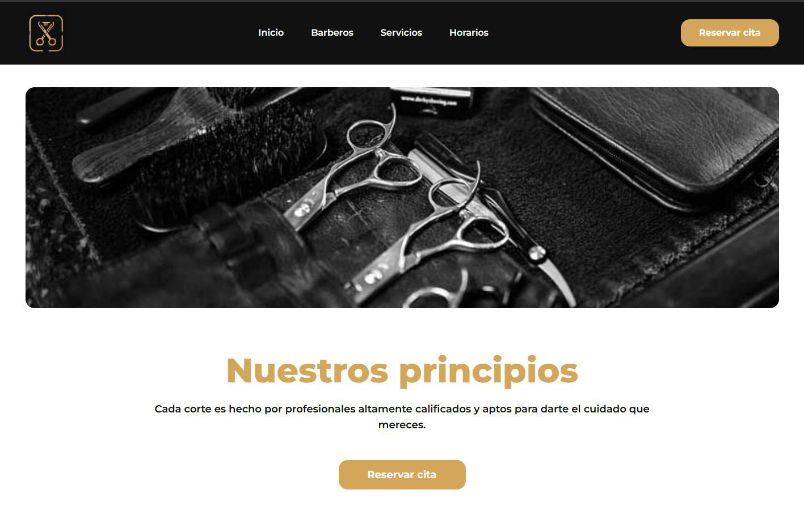
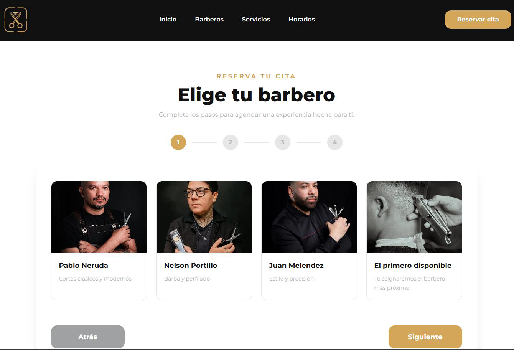
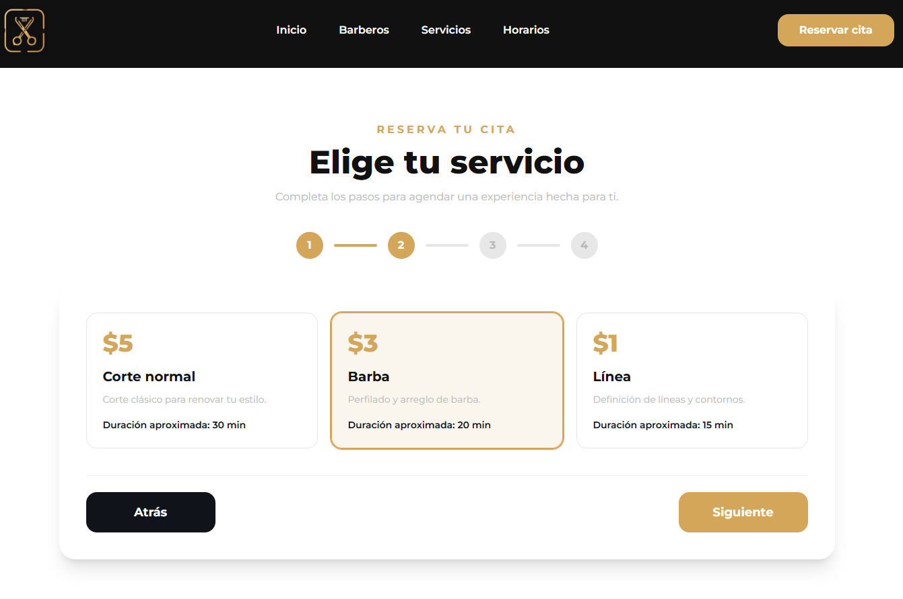
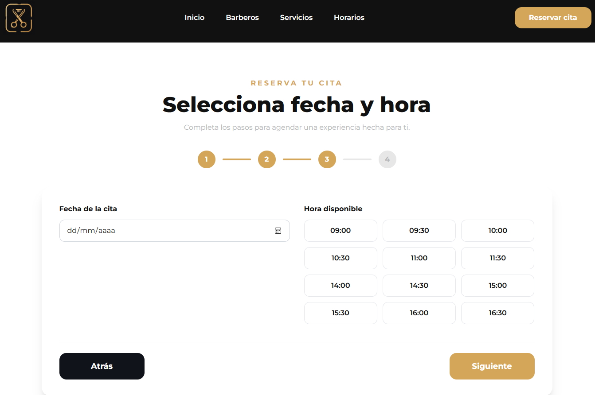
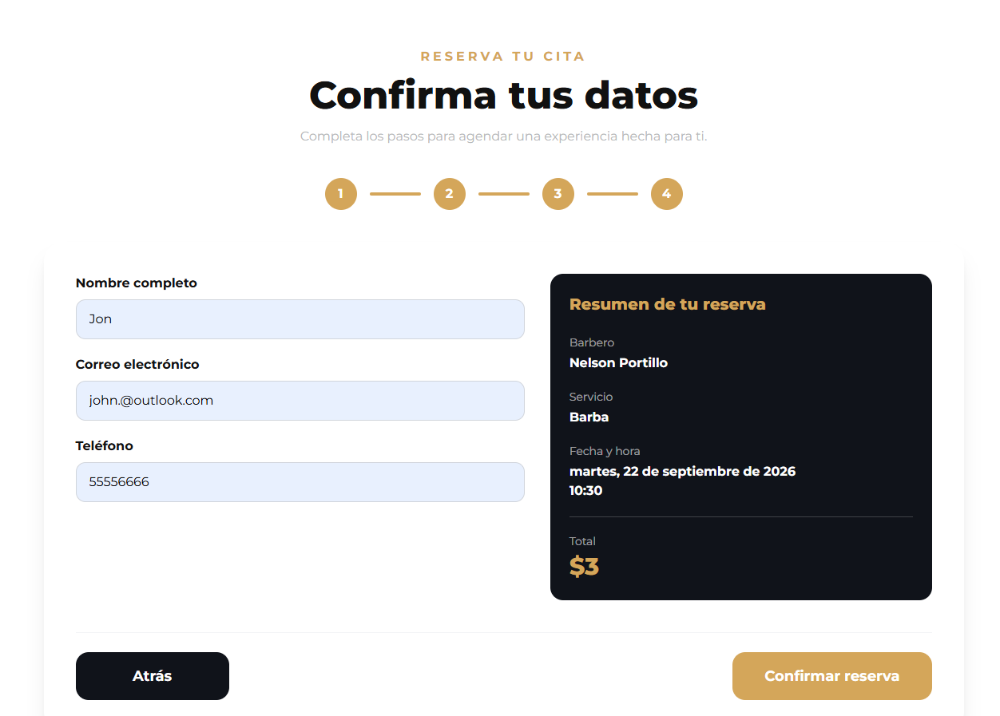
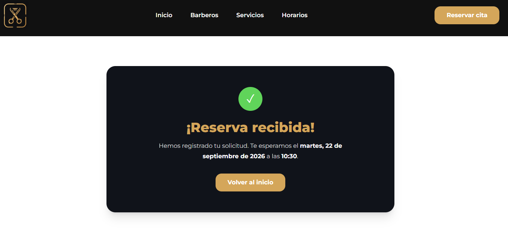
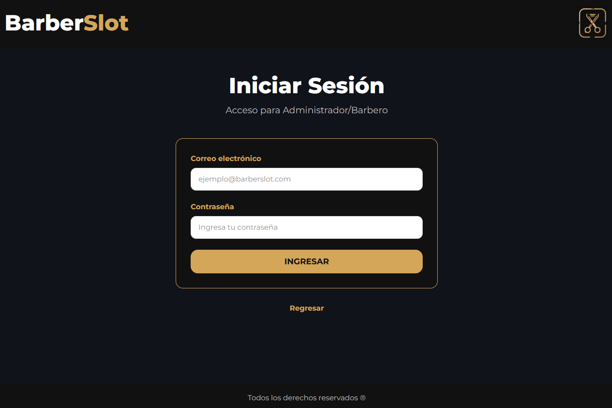
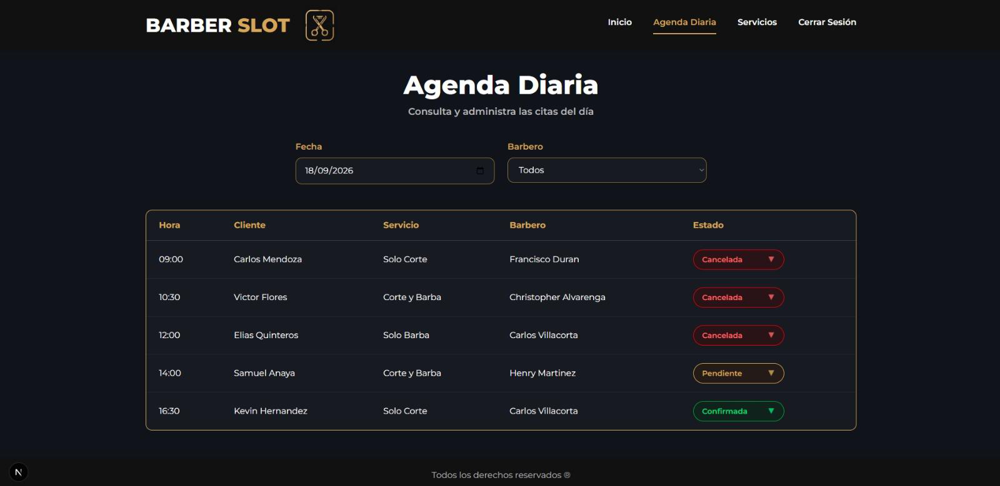
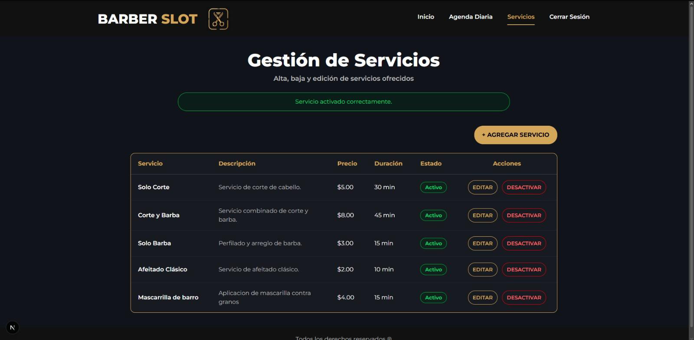
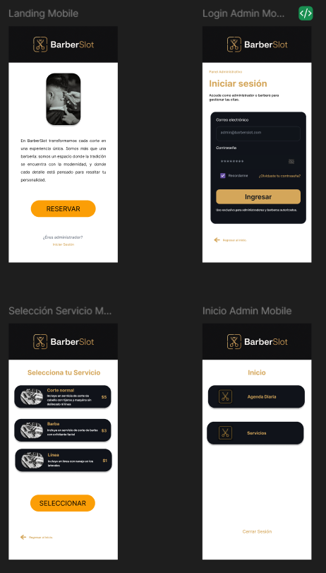

# Documentación BarberSlot

En esta carpeta se encuentra la documentación de diseño del proyecto.

## Mockups

Las interfaces de BarberSlot se diseñaron en Figma antes de su implementación. El archivo de diseño completo puede consultarse en:

[BarberSlot en Figma](https://www.figma.com/design/DtxkBzNf8prr5rXMgWK4zm/BarberSlot?node-id=0-1&t=NpfwyAmPoBClzblo-1)

Las imágenes se encuentran en [`mockups/`](mockups/).

### Sitio web: reserva de citas

El cliente no necesita cuenta para reservar. El flujo inicia en la página principal y continúa en cuatro pasos.

**Página de inicio**

**Paso 1. Selección de barbero**

**Paso 2. Selección de servicio con duración y precio**

**Paso 3. Fecha y horarios disponibles**

**Paso 4. Datos del cliente y resumen**

**Confirmación de la cita**

### Sitio web: panel administrativo

**Inicio de sesión**

**Agenda diaria con filtro por barbero**

**Gestión de servicios**

### Aplicación móvil

Pantallas principales: inicio, inicio de sesión administrativo, selección de servicio e inicio del panel administrativo.

